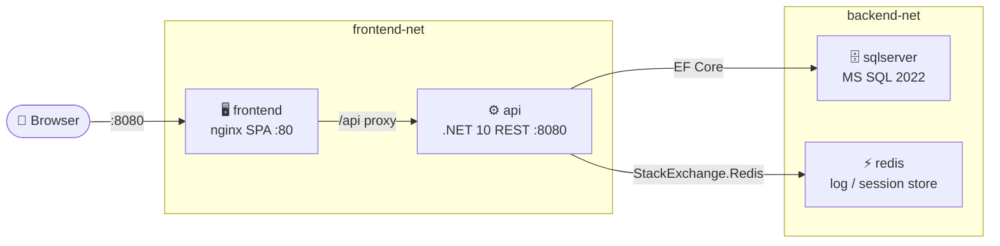
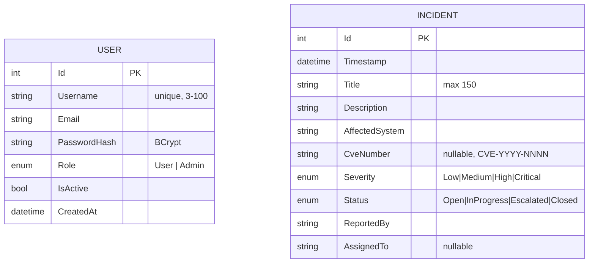
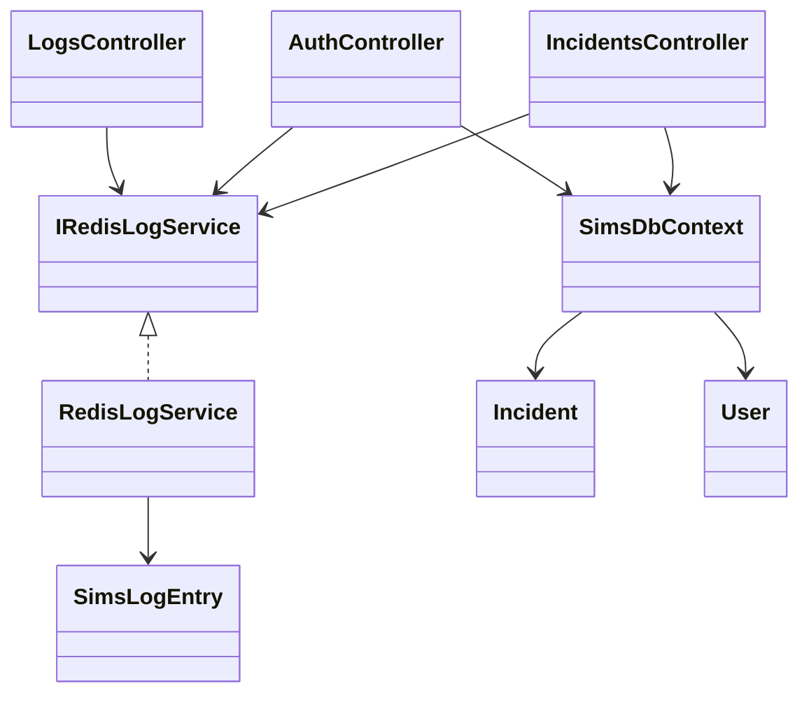

# SIMS — Security Incident Management System


A self-hosted system for **recording, tracking and escalating IT security
incidents**. Analysts log incidents (severity, status, CVE, affected system),
escalate them to other owners/levels, and manage users — all actions are
audit-logged to Redis. The whole stack runs locally in Docker.

---

## ✨ Features

- **Incident management** — create, edit, escalate, close and list incidents
  with filtering by status and severity.
- **User management** — register users, assign roles (`Admin` / `User`),
  activate / deactivate accounts.
- **Authentication** — username / password login with **BCrypt**-hashed secrets.
- **Escalation** — reassign an incident to another owner/level with a reason,
  appended to the incident history.
- **Audit logging** — every relevant action (login, incident & user changes)
  is written as a structured entry to **Redis** and viewable in the UI.
- **Web frontend** — a single-page app for all of the above.
- **REST API** — documented, Swagger-enabled.

---

## 🏗️ Architecture

Four containers across two segmented Docker networks:



- `frontend` talks **only** to `api` (frontend-net).
- `api` talks to `sqlserver` and `redis` (backend-net).
- `sqlserver` and `redis` are **not** published to the host → reduced attack surface.

---

## 🚀 Quick start

> Prerequisite: **Docker Desktop** running.

```bash
git clone https://github.com/remion1/SIMS-AC.git
cd SIMS-AC
cp .env.example .env          # optional: change the SA password
docker compose up --build
```

| Service | URL |
|---------|-----|
| Web UI  | <http://localhost:8080> |
| Swagger | <http://localhost:5080/swagger> |

The API applies EF Core migrations **and seed data automatically** on startup —
no manual `dotnet ef` commands needed.

### Seed credentials

| Username | Password      | Role  |
|----------|---------------|-------|
| `admin`  | `Admin1234!`  | Admin |
| `analyst`| `Analyst1234!`| User  |

---

## 🧰 System requirements

| Requirement | Version |
|-------------|---------|
| OS | Windows 10/11, macOS or Linux (x64) |
| Docker Engine | 24+ with Compose v2 |
| .NET SDK *(only for local backend dev, not required for Docker)* | 10.0 |

---

## 🗂️ Project structure

```
SIMS-AC/
├── docker-compose.yml          # 4-container stack + 2 networks
├── .env.example                # SA password override
├── docs/SAST.md                # Semgrep instructions & results
├── src/
│   ├── backend/Sims.Backend/   # ASP.NET Core REST API (EF Core + Redis)
│   └── frontend/               # nginx-served single-page app
└── README.md
```

---

## 🧱 Data model (ER diagram)



> `USER` and `INCIDENT` are the two persisted SQL entities. `ReportedBy` /
> `AssignedTo` reference users by identifier (email/username) rather than a hard
> FK, so incidents remain readable even if a user is removed. Audit logs live in
> Redis (key `sims:logs`), not in SQL.

### Class diagram (backend core)



---

## 🔌 REST API

Base path `/api`. Full request/response details: see
[`src/backend/Sims.Backend/README_BACKEND.md`](src/backend/Sims.Backend/README_BACKEND.md)
or the live Swagger UI.

| Area | Endpoints |
|------|-----------|
| **Incidents** | `GET /incidents` · `GET /incidents/{id}` · `POST /incidents` · `PUT /incidents/{id}` · `POST /incidents/{id}/escalate` · `POST /incidents/{id}/close` |
| **Auth / Users** | `POST /auth/register` · `POST /auth/login` · `GET /auth/users` · `PUT /auth/users/{id}/status` |
| **Logs** | `GET /logs?count=50` |

---

## 🔐 Security measures

**Implemented**

- **Password hashing** with BCrypt (work factor 12); hashes never leave the API.
- **No sensitive data exposure** — users returned via `UserResponseDto`
  (no `PasswordHash`).
- **SQL-injection safe** — all queries via EF Core parameterisation; no raw SQL.
- **Input validation** — DataAnnotations + `[ApiController]` automatic 400s;
  CVE format enforced by regex.
- **Network segmentation** — SQL Server & Redis unreachable from the host and
  from the frontend network.
- **Secret externalisation** — DB/Redis credentials overridable via `.env` /
  environment variables.
- **HTTP security headers** on the frontend (`X-Content-Type-Options`,
  `X-Frame-Options`, `Referrer-Policy`).
- **SAST** — Semgrep (`--config auto`), see [`docs/SAST.md`](docs/SAST.md).

**Considered / roadmap**

- JWT bearer tokens + per-endpoint role authorisation (currently role is
  returned at login but not yet enforced server-side).
- Rate limiting on the login endpoint.
- Restrictive CORS origins instead of `AllowAll` for production.
- Secrets via a vault instead of `.env`.

---

## 🧪 SAST (Semgrep)

Scanned with Semgrep `--config auto` (1074 rules) on 2026-11-12:
**0 errors, 2 warnings** — both are the intentional demo seed password hashes
(accepted false positives). Full details: **[`docs/SAST.md`](docs/SAST.md)**.

```bash
docker run --rm -v "${PWD}:/src" returntocorp/semgrep semgrep --config auto /src
```

---

## 🗺️ Roadmap (fictional)

- **v1.1** — JWT authentication & role-based endpoint authorisation.
- **v1.2** — Incident attachments & full-text search.
- **v1.3** — Email/Slack notifications on escalation.
- **v2.0** — Multi-tenant support and external incident ingestion (e.g. Jira).

---

## 👥 Contributors

- **Jawid**
- **Rinor**

---

## 📄 License

Released under the [MIT License](LICENSE).

## 🔗 Repository

<https://github.com/remion1/SIMS-AC>
